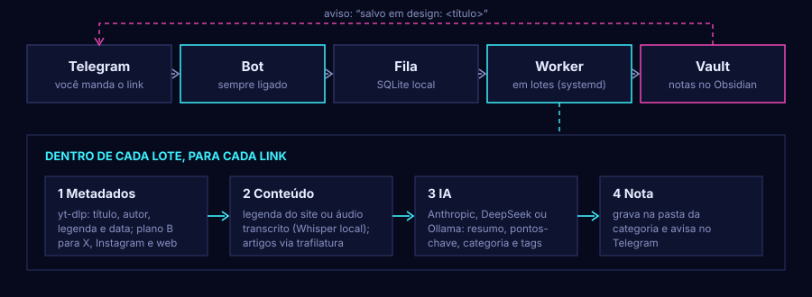
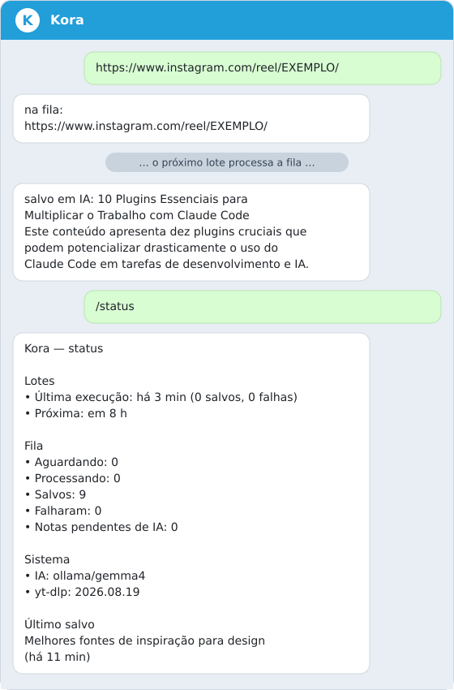
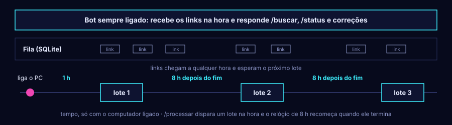

<p align="center"></p>

<h1 align="center">Kora</h1>

<p align="center"><em>Kora</em> = "salvar" em Akan.</p>

Kora é um bot do Telegram que transforma links soltos em notas organizadas no seu vault do Obsidian.
Você manda o link de um Reel, TikTok, tweet, vídeo ou artigo; a Kora baixa o que for preciso, transcreve o
áudio, pede a uma IA um resumo e uma categoria e grava uma nota pronta para consultar (e para os seus
assistentes de IA consultarem).

- [Como funciona](#como-funciona)
- [O que ela salva](#o-que-ela-salva)
- [A nota que ela cria](#a-nota-que-ela-cria)
- [Ferramentas disponíveis](#ferramentas-disponíveis)
- [Instalação e configuração](#instalação-e-configuração)
- [Provedores de IA](#provedores-de-ia)
- [Interface web](#interface-web)
- [Rodando no dia a dia](#rodando-no-dia-a-dia)
- [Estrutura do repositório](#estrutura-do-repositório)
- [Desenvolvimento](#desenvolvimento)
- [Limitações conhecidas](#limitações-conhecidas)
- [Próximos passos](#próximos-passos)

## Como funciona



1. **Entrada.** O bot recebe a mensagem (só do seu `chat_id`; qualquer outro chat é ignorado), extrai as URLs,
   resolve links encurtados (`vt.tiktok.com`, `t.co`…), remove parâmetros de rastreio e grava na fila. Links
   repetidos são reconhecidos pela URL canônica e não são salvos de novo.
2. **Lote.** O worker não fica rodando o tempo todo: um timer o dispara 1 hora depois de ligar o computador e,
   depois, 8 horas após o fim de cada lote. Cada lote esvazia a fila e termina. Você pode pedir um lote na hora
   com `/processar`.
3. **Para cada link, o worker:**
   1. **Extrai os metadados** (título, autor, legenda, data) com `yt-dlp`, com alternativas para o que ele não
      cobre (texto completo de tweets, posts de foto do Instagram, páginas web).
   2. **Obtém o conteúdo:** legenda do vídeo feita pelo próprio site, quando existe; senão baixa só o áudio e
      transcreve com `faster-whisper` (local, na CPU), e apaga o áudio em seguida. Para artigos, extrai o texto
      com `trafilatura`.
   3. **Pede à IA** título, resumo, pontos-chave, categoria e tags, com a taxonomia fixa e as tags que você já
      usa no vault (para reaproveitar em vez de criar sinônimos).
   4. **Grava a nota** em `Referencias/Salvos/<categoria>/` e responde no Telegram:
      `salvo em design: <título>` + a primeira frase do resumo.
4. **Se algo falha**, o item é tentado de novo (3 tentativas, com espera de 1 e 2 minutos dentro do lote). Depois
   disso fica como `falhou` e o bot avisa. Se só a IA falhar, a nota é salva mesmo assim, em `_inbox/` com
   `status: pendente`, e pode ser reprocessada depois (`kora-reclassify`).

O vault é a fonte da verdade: nada importante fica só no banco. A fila SQLite guarda apenas o andamento.

## O que ela salva

| Origem | Metadados | Conteúdo | Observações |
|---|---|---|---|
| **Instagram Reels** | autor, legenda, data | transcrição do áudio | funciona sem login |
| **Instagram post de foto** | autor, legenda | só a legenda | lida pelas tags públicas da página |
| **TikTok (vídeo)** | autor, legenda | transcrição do áudio | exige o `curl_cffi` (já incluído): o TikTok bloqueia clientes sem impersonação |
| **X / Twitter** | autor, data, **texto completo** | transcrição do vídeo, se houver | o `yt-dlp` corta tweets longos; o texto inteiro vem da API pública FixTweet |
| **Artigos e páginas** | título, autor, data | texto do artigo | extraído com `trafilatura`; sem texto suficiente, cai para o título e a descrição |
| **YouTube** | título, canal, descrição | legenda do site ou transcrição | o YouTube pode pedir login (anti-bot) e a Kora ainda não usa cookies; veja [limitações](#limitações-conhecidas) |

Vídeos com mais de `MAX_AUDIO_MINUTES` (30 por padrão) ficam só com a legenda, sem transcrição. Vídeo sem
fala gera nota sem a seção de transcrição, e isso é esperado.

## A nota que ela cria

```markdown
---
criado: 2026-10-17
tipo: link
plataforma: instagram
url: "https://www.instagram.com/reel/DeiT3aSAmvG/"
autor: "Pedro Augusto"
publicado: 2026-10-16
categoria: IA
tags: [claude, plugins, produtividade]
status: processado
ia: "ollama/gemma4"
---

# 10 Plugins Essenciais para Multiplicar o Trabalho com Claude Code

## Resumo
Texto de 3 a 5 linhas.

## Pontos-chave
- Task Observer: aprende seu estilo de trabalho.
- Security Sweep: identifica vulnerabilidades no código.

## Legenda original
Legenda do post, como foi publicada.

## Transcrição
> [!note]- Transcrição completa
> Linha a linha, em um bloco recolhido no Obsidian.
```

`status` é `processado` quando a IA classificou e `pendente` quando não. Artigos trazem `## Conteúdo` no lugar da
transcrição. Reprocessar o mesmo link sobrescreve a mesma nota, não cria cópia.

### Categorias

| Categoria | O que entra |
|---|---|
| `programação` | código, arquitetura, DevOps, repositórios e ferramentas de desenvolvimento |
| `IA` | modelos, agentes, técnicas e novidades de inteligência artificial em si |
| `design` | UI/UX, motion, inspiração visual, identidade visual |
| `negócios` | marketing, vendas, produto, freelas, carreira |
| `finanças` | investimentos, economia pessoal, impostos |
| `saúde` | exercício, alimentação, sono, saúde mental |
| `casa` | plantas, decoração, organização, manutenção |
| `receitas` | culinária |
| `humor` | memes e vídeos engraçados |
| `outros` | quando nada se encaixa |

**Regra de desempate:** a categoria é o assunto principal do que o conteúdo *ensina*; a ferramenta usada vira
tag. "Claude faz motion graphics" vai para `design` com a tag `ia`; "os 10 repositórios do GitHub para agentes"
vai para `IA` com a tag `github`. A lista de fábrica fica em `src/kora/taxonomia.py`; ao editar as categorias na
[interface web](#interface-web), ela passa a vir de `data/categorias.json`.

## Ferramentas disponíveis

### Comandos e gestos no Telegram

<p align="center"></p>
<p align="center"><sub>Ilustração montada com respostas reais do bot.</sub></p>

| O que fazer | Para que serve |
|---|---|
| Enviar um ou mais links | Entram na fila. O bot responde `na fila: …`, ou `já salvo: …` se já existir |
| `/buscar <termos>` | Lista até 5 notas que contêm **todos** os termos. Ignora maiúsculas e acentos; título e tags pesam mais que o corpo. Ex.: `/buscar motion claude` |
| `/status` | Última e próxima execução, fila, notas pendentes de IA, provedor de IA, versão do `yt-dlp`, último salvo e falhas recentes |
| `/processar` | Dispara um lote agora, sem esperar o timer |
| Responder ao aviso do bot com `categoria: design` | Move a nota para a pasta da categoria e atualiza o frontmatter. Aceita as 10 categorias, sem diferenciar maiúsculas. Para links antigos, responda à sua própria mensagem com o link |

### Linha de comando

| Comando | O que faz |
|---|---|
| `uv run kora-bot` | Inicia o bot (long polling) |
| `uv run kora-worker --once` | Roda **um lote**: esvazia a fila e sai (é o que o timer executa) |
| `uv run kora-worker` | Worker contínuo, em loop (útil em desenvolvimento) |
| `uv run kora-web [--porta N]` | Interface web local em `http://127.0.0.1:8765`: galeria, fila e ajustes |
| `uv run kora-reclassify [--limit N]` | Reprocessa notas com `status: pendente` (a IA estava fora do ar ou desligada). Mantém a data de criação e respeita categoria definida à mão. Para depois de 3 falhas seguidas do provedor |

### Serviços e scripts (`deploy/`)

| Arquivo | Função |
|---|---|
| `install.sh` / `install.sh uninstall` | Instala (ou remove) os serviços no `systemd --user`. Migra o worker contínuo antigo |
| `kora-bot.service` | Bot sempre ligado, com reinício automático em falha |
| `kora-web.service` | Interface web local, sempre ligada |
| `kora-worker.service` + `kora-worker.timer` | Lote do worker: 1 h após o boot, depois 8 h após o fim de cada lote |
| `kora-ytdlp-update.timer` | Atualiza o `yt-dlp` todo dia (os sites mudam e quebram versões antigas) |
| `update-ytdlp.sh` | O que o timer acima executa. Com `KORA_YTDLP_NIGHTLY=1` segue as versões nightly |

### No Obsidian

- **Índice `Referencias/Salvos/Salvos.md`:** criado uma única vez pelo worker, com consultas Dataview:
  recentes, por categoria, por plataforma, por tag, por mês e pendentes de IA. Pode ser editado à vontade; a
  Kora nunca o sobrescreve.
- **`CLAUDE.md` do vault:** tem uma seção "Links salvos (Kora)" que ensina assistentes de IA a achar e citar as
  notas (filtrar pelo frontmatter, depois buscar o texto, e citar o `url`).

## Instalação e configuração

**Requisitos:** Linux com `systemd` (para rodar como serviço), [uv](https://docs.astral.sh/uv/), Python 3.12+ e um
vault do Obsidian. Para a IA local, o [Ollama](https://ollama.com/). O plugin Dataview do Obsidian é necessário
só para o índice `Salvos.md`.

1. **Crie o bot** no [@BotFather](https://t.me/BotFather) e guarde o token.
2. **Descubra o seu `chat_id`:** mande uma mensagem ao bot e abra
   `https://api.telegram.org/bot<TOKEN>/getUpdates`; o número está em `"chat":{"id":…}`. (Não cole o token em
   lugar nenhum além do `.env`.)
3. **Instale e configure:**

   ```bash
   git clone https://github.com/Joaovitor12j/kora.git && cd kora
   uv sync
   cp .env.example .env     # preencha TELEGRAM_BOT_TOKEN, TELEGRAM_ALLOWED_CHAT_ID e VAULT_PATH
   ```

4. **Escolha a IA** (opcional, mas é ela que dá resumo e categoria): defina `LLM_PROVIDER` no `.env`; veja
   [Provedores de IA](#provedores-de-ia).
5. **Rode** à mão para testar ou como serviço; veja [Rodando no dia a dia](#rodando-no-dia-a-dia).

### Variáveis do `.env`

| Variável | Padrão | Descrição |
|---|---|---|
| `TELEGRAM_BOT_TOKEN` | — | Token do bot (@BotFather). Obrigatório |
| `TELEGRAM_ALLOWED_CHAT_ID` | — | Único chat aceito. Obrigatório |
| `VAULT_PATH` | — | Caminho absoluto do vault. Obrigatório |
| `VAULT_SAVED_DIR` | `Referencias/Salvos` | Pasta das notas, dentro do vault |
| `DB_PATH` | `data/queue.sqlite` | Banco da fila (e arquivos de estado ao lado dele) |
| `LOG_LEVEL` | `INFO` | Nível de log |
| `LLM_PROVIDER` | vazio | `anthropic`, `deepseek` ou `ollama`. Vazio desliga a IA |
| `LLM_TIMEOUT` | `60` | Segundos de espera por resposta da API |
| `LLM_MAX_CHARS` | `12000` | Limite de conteúdo enviado ao modelo (a legenda recebe um quarto disso) |
| `ANTHROPIC_API_KEY` / `ANTHROPIC_MODEL` | — / `claude-haiku-5-5` | Chave e modelo da Anthropic |
| `DEEPSEEK_API_KEY` / `DEEPSEEK_MODEL` | — / `deepseek-flash` | Chave e modelo da DeepSeek |
| `OLLAMA_BASE_URL` / `OLLAMA_MODEL` | `http://localhost:11434` / `gemma4` | Servidor e modelo local |
| `WHISPER_MODEL` | `small` | Modelo do `faster-whisper` (CPU, `int8`) |
| `WHISPER_LANGUAGE` | vazio | Vazio detecta o idioma; ou `pt`, `en`… |
| `MAX_AUDIO_MINUTES` | `30` | Acima disso, só a legenda |

O `.env` está no `.gitignore`, assim como `data/` e arquivos `cookies*.txt`. Segredos nunca vão para o vault nem
para o repositório.

## Provedores de IA

`LLM_PROVIDER` escolhe **um** provedor por vez; cada um funciona sozinho. A resposta é sempre um JSON com
`titulo`, `resumo`, `pontos_chave`, `categoria` e `tags`, validado antes de virar nota: categoria fora da lista
vira `outros`, tags são normalizadas e resumo vazio é rejeitado.

| Provedor | Como é chamado | Modelo padrão | Observações |
|---|---|---|---|
| `anthropic` | SDK oficial, com *structured outputs* (JSON Schema) | `claude-haiku-5-5` | Pago, por token. Tende a acertar mais a categoria |
| `deepseek` | API compatível com OpenAI, modo JSON | `deepseek-flash` | Pago, mais barato. O modo JSON às vezes devolve vazio; a nota fica pendente |
| `ollama` | `/api/chat` com schema | `gemma4` | Grátis e local; mais lento e menos preciso na categoria |

Se a chave faltar ou o nome estiver errado, o worker nem inicia (o erro aparece na partida, não na primeira nota).
Se a chamada falhar, a nota sai em `_inbox/` como `pendente`. Hoje **não há fallback automático** entre
provedores; veja o item 1 de [Próximos passos](#próximos-passos).

## Interface web

```bash
uv run kora-web        # ou, com o deploy/install.sh, já fica ligada: http://127.0.0.1:8765
```

Três abas. O vault continua sendo a fonte da verdade: a galeria só lê as notas e, quando você corrige uma
categoria, move o arquivo como o bot já faz.

- **Salvos:** busca ao digitar (`/` foca o campo; mesma busca do `/buscar`, sem acento), filtros por categoria,
  plataforma, período e tag, e os links agrupados por dia. Clicar abre um painel com resumo, pontos-chave,
  legenda, transcrição, o link original e a troca de categoria. Notas sem classificação ficam em "Sem categoria".
  Cada categoria tem um sigilo próprio, desenhado em traço fino.
- **Fila:** o que está em andamento, esperando o lote, falhou (com o erro) e aguarda IA, mais o botão
  "Processar agora", que dispara um lote como o `/processar` do bot.
- **Ajustes:** provedor de IA e modelo (com teste de conexão e, no Ollama, os modelos instalados), chaves de API,
  intervalo dos lotes, modelo de transcrição, limites e categorias. Salvar reescreve o `.env` (preservando
  comentários e a permissão do arquivo), grava `data/categorias.json`, grava o intervalo em
  `~/.config/systemd/user/kora-worker.timer.d/intervalo.conf` e reinicia o bot. O worker roda em lote e lê tudo
  no próximo.

**Segurança.** Só escuta em `127.0.0.1`. Toda requisição confere o `Host` (contra DNS rebinding) e toda escrita
exige JSON e `Origin` local, então uma página aberta no navegador não consegue acionar o painel. As chaves de API
são só gravadas: a tela nunca as mostra (um campo em branco mantém a chave salva). Categorias renomeadas ou
removidas não movem notas já salvas, e o nome vira pasta no vault (por isso `/ \ : * ? " < > |` são recusados).

### Acesso de fora (Tailscale)

Para abrir a Kora no celular ou em outro computador, sem expor nada na internet: o servidor continua escutando só
em `127.0.0.1` e o [Tailscale](https://tailscale.com) (rede privada entre os seus dispositivos) publica a porta com
HTTPS. O computador da Kora precisa estar ligado.

1. Instale o Tailscale no computador da Kora e no celular, com a mesma conta, e rode no computador:

   ```bash
   sudo tailscale up
   tailscale serve --bg 8765
   ```

   O comando mostra o endereço, algo como `https://meu-pc.rede.ts.net`.
2. Diga à Kora quem pode entrar, em Ajustes, na seção "Acesso de fora" (ou no `.env`):

   ```
   WEB_HOSTS=meu-pc.rede.ts.net
   WEB_ALLOWED_USERS=voce@exemplo.com
   ```

   Vale na hora, sem reiniciar. Quem muda essa lista só pode ser quem abre a Kora no próprio computador.
3. Abra o endereço no celular, com o Tailscale ligado.

**Como protege.** O `tailscale serve` põe o login de quem está na sua rede no cabeçalho `Tailscale-User-Login`, e a
Kora só deixa entrar quem está em `WEB_ALLOWED_USERS` e usa um host de `WEB_HOSTS`. Isso só é confiável porque a
porta local não é alcançável por mais ninguém: nunca use `tailscale funnel` (que torna a porta pública) nem
mude o servidor para escutar fora de `127.0.0.1`. Sem `WEB_ALLOWED_USERS`, todo acesso de fora é recusado. Quem
entra de fora vê um aviso no topo e não consegue mudar a lista de quem pode entrar.

## Rodando no dia a dia

**À mão** (dois terminais):

```bash
uv run kora-bot
uv run kora-worker          # contínuo; ou: uv run kora-worker --once
```

**Como serviço** (recomendado). Pare o bot e o worker que estiverem em terminais, porque dois bots com o mesmo
token disputam as mensagens, e rode:

```bash
deploy/install.sh
```

O bot passa a ficar sempre ligado e o worker roda em lotes (1 h após ligar o computador e 8 h depois do fim de
cada lote; só conta o tempo com a máquina ligada).


 O aviso "salvo em …" de cada link chega quando o lote o
processa, então pode demorar até 8 h; use `/processar` para não esperar.

```bash
systemctl --user list-timers 'kora-*'      # próximas execuções
journalctl --user -u kora-worker -f        # logs dos lotes
journalctl --user -u kora-bot -f           # logs do bot
loginctl enable-linger "$USER"             # opcional: sobe no boot, sem login
deploy/install.sh uninstall                # remove tudo
```

Para mudar o ritmo, use a aba Ajustes da [interface web](#interface-web) ou edite `OnBootSec` e
`OnUnitInactiveSec` com `systemctl --user edit kora-worker.timer`.

Os logs de HTTP ficam silenciados de propósito: a URL da API do Telegram carrega o token do bot.

## Estrutura do repositório

```
src/kora/
├── bot.py             # Telegram: links, /buscar, /status, /processar, correção de categoria
├── worker.py          # lote (--once) e modo contínuo; orquestra extração, IA e nota
├── urls.py            # extrai, resolve e canonicaliza URLs
├── db.py              # fila SQLite: status, tentativas, backoff
├── extractors/        # yt-dlp, legendas, artigos (trafilatura), alternativas (FixTweet, og:tags, oEmbed)
├── media.py           # legenda do site ou áudio -> transcrição
├── transcribe.py      # faster-whisper
├── llm/               # provedores (anthropic, deepseek, ollama), prompt, schema
├── classificar.py     # aplica a resposta da IA ao Meta
├── taxonomia.py       # categorias e regra de desempate
├── vault.py           # escreve, lê e move notas; tags existentes
├── busca.py           # /buscar
├── correcao.py        # "categoria: X" por resposta
├── reclassificar.py   # kora-reclassify
├── indice.py          # cria o Salvos.md
├── agenda.py          # registro das execuções e consulta ao timer do systemd
├── status.py          # texto do /status
├── web/               # interface web: app.py (rotas), acervo.py (galeria), ajustes.py, templates/, static/
└── config.py, logs.py, telegram_api.py
deploy/                # units do systemd e scripts de instalação
docs/PLANO.md          # plano, decisões e resultados da validação técnica
spike/                 # scripts da Fase 0 (testar links e medir o Whisper)
tests/                 # testes automatizados
```

## Desenvolvimento

```bash
uv sync
uv run pytest          # a suíte inteira roda em poucos segundos, sem rede
```

Os testes não chamam a rede nem o systemd real: provedores de IA, Telegram e `systemctl` são simulados. As
decisões e o histórico das fases estão em [docs/PLANO.md](docs/PLANO.md).

## Limitações conhecidas

- **Retenção do Telegram:** o Telegram guarda mensagens não lidas por 24 h. Se o bot ficar parado por mais
  tempo, os links enviados nesse intervalo se perdem. A fila local não tem esse limite, porque o bot a alimenta
  na hora.
- **Atraso dos lotes:** a nota e o aviso chegam quando o lote roda (até 8 h). `/processar` resolve na hora.
- **TikTok em carrossel (`/photo/`):** nenhum extrator funciona, então o link é salvo só com a URL e falha.
- **YouTube:** pode exigir login por causa do anti-bot, e a Kora ainda não usa cookies.
- **Instagram e TikTok mudam:** o `yt-dlp` quebra de tempos em tempos; por isso a atualização diária.
- **Categoria com modelo local pequeno:** o `gemma4` às vezes erra (por exemplo, um tweet de repositórios de
  IA caiu em `programação`). Corrija respondendo `categoria: X`.
- **Um provedor de IA por vez, sem fallback.**
- **Busca simples:** varre os arquivos do vault (todos os termos, sem acento). Basta até algumas centenas de
  notas; depois disso, embeddings.

## Próximos passos

Nada abaixo está implementado ainda. A interface configurável e a galeria dos links salvos já saíram (veja [Interface web](#interface-web)).

### 1. Orquestrador de IA com fallback
Hoje cada provedor funciona sozinho e, se ele falhar, a nota fica pendente. O orquestrador tentaria vários em
ordem configurável (por exemplo Anthropic, depois DeepSeek, depois Ollama), passando ao próximo quando houver
erro, limite de uso ou JSON inválido, e registraria quem respondeu (o campo `ia` da nota já existe). A interface
`Provider.complete()` já foi pensada para isso: o orquestrador entra por cima, sem mexer nos provedores.
*Decisões em aberto:* ordem fixa ou por custo/latência; limite de gasto; rotear por tipo de conteúdo.

### 2. Bot no WhatsApp
Um segundo canal de entrada, com o mesmo fluxo e os mesmos comandos. Para isso, o que hoje está acoplado ao
Telegram (`bot.py`, `telegram_api.py`) viraria uma interface de "canal" (receber link, responder, tratar
comandos), com um adaptador por plataforma.
*Decisões em aberto:* a API oficial (WhatsApp Business Cloud API) exige conta Meta, webhook público e modelos de
mensagem; as bibliotecas não oficiais são mais simples, mas arriscam bloqueio do número.

### 3. Tradução para o idioma escolhido
Conteúdo em outros idiomas seria traduzido para o idioma que você selecionar (`pt-BR` por padrão). Hoje o
resumo e os pontos-chave já saem em português por instrução do prompt, mas o idioma é fixo e a transcrição, o
artigo e a legenda ficam no original. A ideia: idioma-alvo configurável, detectar o idioma de origem (o Whisper
já detecta o do áudio), traduzir título, resumo e pontos-chave e, opcionalmente, o conteúdo completo numa seção
"Tradução", sempre guardando o original.
*Decisões em aberto:* traduzir tudo ou só o resumo; qual provedor traduz (custo de textos longos).

### Menores, sem prazo
- Cookies para o YouTube e outros sites que exigem login.
- Suporte ao carrossel `/photo/` do TikTok.
- Embeddings locais (`sqlite-vec`) e um servidor MCP com `buscar_salvos(pergunta)`, quando o volume passar de
  algumas centenas de notas.
